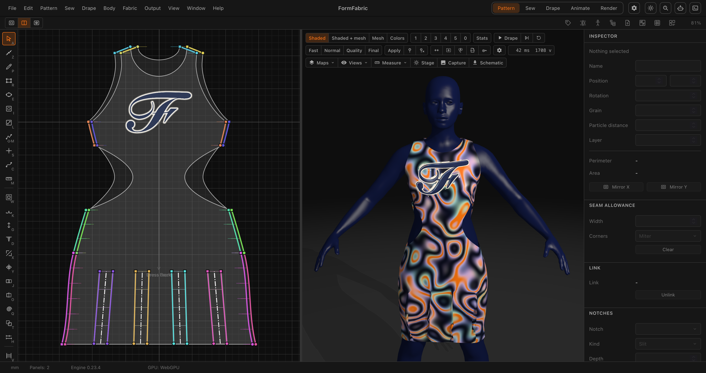

<p align="center">
  
</p>

<h1 align="center">FormFabric</h1>

<p align="center">
  <b>Garment design; sewing patterns draped on a body with a real cloth simulation.</b><br>
  Draw pattern pieces, sew them edge to edge, drape them, animate and export,<br>
  in one window on your own computer. Agents drive it over MCP.
</p>

<p align="center">
  
  
  
  
  
  
</p>

<p align="center">
  <a href="https://formai.studio/"><b>Download FormFabric on formai.studio</b></a> ·
  <a href="#run-it-from-source">Run it from source</a> ·
  <a href="#the-form-family">All Form apps</a>
</p>

<br>

<p align="center">
  
  <br>
  <sub>The Pattern workspace: the flat dress pieces on the left, the printed dress draped on a body in the 3D View.</sub>
</p>

<p align="center"><a href="#features">Features</a> · <a href="#everything-in-the-box">In the box</a> · <a href="#built-for-agents">Agents</a> · <a href="#under-the-hood">Under the hood</a> · <a href="#download">Download</a> · <a href="#run-it-from-source">Run from source</a> · <a href="#the-form-family">Form family</a></p>

<br>

<table>
  <tr>
    <td width="25%" valign="top"><h3>Pattern first</h3>Draw panels in millimetres with exact numeric input, darts, notches and seam allowance, and exchange them as DXF-AAMA.</td>
    <td width="25%" valign="top"><h3>Real cloth</h3>A native solver settles the fabric under gravity, contact and seams, with an opt-in GPU path on Metal, Vulkan and DX12.</td>
    <td width="25%" valign="top"><h3>To any 3D tool</h3>Export OBJ, FBX, glTF, USD and Alembic with UVs and caches, or save the whole garment as a <code>.ffbrc</code> project.</td>
    <td width="25%" valign="top"><h3>Agent-ready</h3>Every action is one engine command, so the window, a Python script and an AI agent over MCP drive the same document.</td>
  </tr>
</table>

<br>

## Features

- **Sewing patterns.** Flat panels carry seams, darts, grain lines and notches, with a live seam check in millimetres.
- **Exact drafting.** Draw panels in millimetres with numeric input, seam allowance and DXF-AAMA exchange.
- **Cloth simulation.** Fast, normal, quality and final presets, with pins, wind and body collision with skin offset.
- **Real bodies.** Drape on CC0 MPFB2 bodies or a Basic Form, then refit and re-drape as the pattern changes.
- **Finishing details.** Zippers, buttons, topstitch, piping, elastic, pleats and gather.
- **Animation.** A timeline with motion import and retargeting, recorded caches in layers, and keys for wind, fabric values and pins.
- **Export.** Weld or unweld, thick or thin, quad remesh with seam-matched borders, texture baking and game-ready output.
- **Any 3D tool.** OBJ, FBX, glTF, USD and Alembic with UVs and caches, or the whole garment as a `.ffbrc` project.

## Everything in the box

<table>
  <tr>
    <td width="33%" valign="top">
      <h4>Draft and sew</h4>
      Panels · Rectangles and ellipses · Curve tools · Darts · Slash and spread · Mirror and linked instances · Seams · Pleats · Gather · Tack
    </td>
    <td width="33%" valign="top">
      <h4>Drape and finish</h4>
      CC0 MPFB2 bodies · Basic Form · Pins · Grab and pinch · Fit shell · Refit and re-drape · Zippers · Buttons · Topstitch · Piping · Elastic
    </td>
    <td width="33%" valign="top">
      <h4>Formats</h4>
      Opens: <code>.ffbrc</code>, DXF-AAMA, OBJ, glTF, FBX, Alembic · Saves: <code>.ffbrc</code>, OBJ, FBX, glTF, GLB, USD, Alembic, MDD, PC2 · Native: <code>.ffbrc</code>
    </td>
  </tr>
</table>

## Built for agents

255 engine commands are declared once, in one registry; the UI, the Python package and the MCP server call the same ones.

```sh
./formfabric py -m formfabric commands   # list the engine commands
./formfabric py my_script.py             # run a script against the engine
./formfabric mcp                         # MCP server on stdio for Claude Code, Codex and Cursor
```

`.mcp.json`, `.codex/config.toml` and `.cursor/mcp.json` are already wired in this repo. See [`AGENTS.md`](AGENTS.md).

## Under the hood

- **Engine:** a Rust workspace of 14 crates, with a native cloth solver (block descent and implicit) and an opt-in wgpu compute path
- **Interface:** vanilla TypeScript and Vite, with the shared Form shell, zero flash on load and every string in 30 languages
- **Service:** Python and FastAPI on 127.0.0.1 only, with autosave, a recovery journal and plugins
- **Desktop:** Tauri 2, with the engine as a sidecar and the frame stream as a binary WebSocket
- **Scripting:** a standard-library Python package, plus a Live Link that streams a USD layer to Unreal

## Download

**Get the app:** download FormFabric from [formai.studio](https://formai.studio/). That is the easiest way to install it.

**Keep it updated:** [FormPortal](https://github.com/nodemode-dev/formportal) installs, updates and rolls back every Form app from the same signed catalogue.

Not released yet. Run it from source below.

Releases are compiled and published from [`nodemode-dev/formcompiler`](https://github.com/nodemode-dev/formcompiler/releases), not from this repo. This repo holds the source.

## Run it from source

Prefer it in your browser, or want to contribute? Run the web UI straight from this repo.

**Requires:** Node 20.19+ (22 recommended), Python 3.12+, and Rust at the version pinned by `rust-toolchain.toml` (installed by `rustup`). `./formfabric doctor` checks them.

```sh
git clone git@github.com:nodemode-dev/formfabric.git
cd formfabric
./formfabric_oc_install     # installs the backend, the engine and the frontend
./formfabric                # web UI at http://localhost:5280
```

`./formfabric desktop dev` opens the desktop window instead.

On Windows use `formfabric_oc_install.bat` and `formfabric.bat`. The backend listens on 127.0.0.1:8280 only. `FORMFABRIC_DATA_DIR` moves autosaves, recovery and the Library.

> [!IMPORTANT]
> **Status:** pre-1.0. The GPU path and solver speed on real hardware, the Unreal run and a few other items still wait for sign-off before v1.0.0.

**Contributing:** branch from `main`, keep changes to source here, and leave packaging and releases to formcompiler. See [`.docs/BRANCHING.md`](.docs/BRANCHING.md) and [`AGENTS.md`](AGENTS.md).

Layout: `native/` (engine), `frontend/`, `backend/`, `python/`, `src-tauri/`, `setup/`, `assets/`. Docs: [`.docs/wiki`](.docs/wiki) · Agents: [`CLAUDE.md`](CLAUDE.md), [`AGENTS.md`](AGENTS.md) · Contributing: [`.docs/BRANCHING.md`](.docs/BRANCHING.md)

## The Form family

FormFabric is one of the **Form apps**: native creative tools that install, update and roll back through FormPortal and can all be driven by agents.

| | App | What it's for | Download | Code |
|:-:|---|---|---|---|
|  | **form.md** | Documents, databases and realtime editing together | [formai.studio](https://formmd.formai.studio/) | [GitHub](https://github.com/nodemode-dev/form.md) |
|  | **FormAT** | Chat and agent workspace on your key | [formai.studio](https://format.formai.studio/) | [GitHub](https://github.com/nodemode-dev/format) |
|  | **FormCAD** | Drafting, parametric parts and NURBS surfaces | | [GitHub](https://github.com/nodemode-dev/formCAD) |
|  | **FormCel** | Spreadsheets agents can read and edit | [formai.studio](https://formcel.formai.studio/) | [GitHub](https://github.com/nodemode-dev/formcel) |
|  | **FormCraft** | Generate images, video, audio, 3D and worlds | | [GitHub](https://github.com/nodemode-dev/formcraft) |
|  | **FormCut** | Multi-track video editing with no upload | [formai.studio](https://formcut.formai.studio/) | [GitHub](https://github.com/nodemode-dev/formcut) |
|  | **FormDAM** | Photo library and asset manager | [formai.studio](https://formdam.formai.studio/) | [GitHub](https://github.com/nodemode-dev/formDAM) |
|  | **FormDeck** | Presentations and pitch decks | [formai.studio](https://formdeck.formai.studio/) | [GitHub](https://github.com/nodemode-dev/formdeck) |
|  | **FormDesign** | Page layout for print and the web | [formai.studio](https://formdesign.formai.studio/) | [GitHub](https://github.com/nodemode-dev/formdesign) |
|  | **FormEncoder** | Media encoding queue with presets | [formai.studio](https://formencoder.formai.studio/) | [GitHub](https://github.com/nodemode-dev/formencoder) |
|  | **FormFabric** | Sewing patterns draped with cloth simulation | | [GitHub](https://github.com/nodemode-dev/formfabric) |
|  | **FormLit** | Photo library and raw development | [formai.studio](https://formlit.formai.studio/) | [GitHub](https://github.com/nodemode-dev/formlit) |
|  | **FormMorpheus** | Frame-by-frame and performed animation | | [GitHub](https://github.com/nodemode-dev/formmorpheus) |
|  | **FormNET** | See what your computer sends online | | [GitHub](https://github.com/nodemode-dev/formNET) |
|  | **FormPath** | Vector illustration with artboards and type | [formai.studio](https://formpath.formai.studio/) | [GitHub](https://github.com/nodemode-dev/formpath) |
|  | **FormPDF** | Edit, redact, sign and fill PDFs | [formai.studio](https://formpdf.formai.studio/) | [GitHub](https://github.com/nodemode-dev/formpdf) |
|  | **FormPromo** | Promo films from your own media | [formai.studio](https://formpromo.formai.studio/) | [GitHub](https://github.com/nodemode-dev/formpromo) |
|  | **FormRef** | Reference boards for creative work | [formai.studio](https://formref.formai.studio/) | [GitHub](https://github.com/nodemode-dev/formref) |
|  | **FormRig** | Rig, skin and retarget any mesh | | [GitHub](https://github.com/nodemode-dev/formrig) |
|  | **FormSculpt** | 3D sculpting, remeshing and painting | [formai.studio](https://formsculpt.formai.studio/) | [GitHub](https://github.com/nodemode-dev/formsculpt) |
|  | **FormSurface** | Texture painting with PBR export | [formai.studio](https://formsurface.formai.studio/) | [GitHub](https://github.com/nodemode-dev/formsurface) |
|  | **FormTools** | Viewers, batch tools and file utilities | | [GitHub](https://github.com/nodemode-dev/formtools) |
|  | **FormTxt** | Word processing with .docx round trips | [formai.studio](https://formtxt.formai.studio/) | [GitHub](https://github.com/nodemode-dev/formtxt) |
|  | **FormVFX** | Motion graphics and VFX compositing | [formai.studio](https://formvfx.formai.studio/) | [GitHub](https://github.com/nodemode-dev/formvfx) |
|  | **FormVis** | Layered image editing with local AI | [formai.studio](https://formvis.formai.studio/) | [GitHub](https://github.com/nodemode-dev/formvis) |
|  | **FormWav** | Multitrack audio editing and mixing | [formai.studio](https://formwav.formai.studio/) | [GitHub](https://github.com/nodemode-dev/formwav) |
|  | **FormWeb** | Visual website building with a CMS | [formai.studio](https://formweb.formai.studio/) | [GitHub](https://github.com/nodemode-dev/formweb) |
|  | **FormPortal** | Install, update and roll back Form apps | [formai.studio](https://formportal.formai.studio/) | [GitHub](https://github.com/nodemode-dev/formportal) |
|  | **FormTray** | One dock icon for every app | [formai.studio](https://formtray.formai.studio/) | [GitHub](https://github.com/nodemode-dev/formtray) |
|  | **FormMCP** | One MCP connection to the family | [formai.studio](https://formmcp.formai.studio/) | [GitHub](https://github.com/nodemode-dev/formMCP) |
|  | **FormSkills** | Every app's agent skills in one place | [formai.studio](https://formskill.formai.studio/) | [GitHub](https://github.com/nodemode-dev/formskills) |
|  | **FormBench** | Parity, testing and rankings for the family | [formai.studio](https://formranker.formai.studio/) | [GitHub](https://github.com/nodemode-dev/formbench) |
|  | **FormSlot** | Codebase memory for coding agents | | [GitHub](https://github.com/nodemode-dev/formslot) |
|  | **SubForm** | Workbench for parallel Claude Code agents | | [GitHub](https://github.com/nodemode-dev/subform) |
|  | **FormCompiler** | Builds, signs and releases every app | [formai.studio](https://formcompiler.formai.studio/) | [GitHub](https://github.com/nodemode-dev/formcompiler) |
|  | **FormPipe** | Release pipeline and update feeds | | [GitHub](https://github.com/nodemode-dev/formpipe) |

<br>

---

## Maintainers

| Maintainer | Role |
|---|---|
| [@nodemode-ai](https://github.com/nodemode-ai) | Owner |
| [@gbarnai](https://github.com/gbarnai) | Co-owner |

Code owners are set in [`.github/CODEOWNERS`](.github/CODEOWNERS).

## License

FormFabric is licensed under the Apache License 2.0 ([`LICENSE`](LICENSE), SPDX `Apache-2.0`). Copyright 2026 NodeAgentc, Inc. Third-party notices: [`NOTICE.md`](NOTICE.md).

<sub>Screenshot content: the owner's dress project on a CC0 MPFB2 body.</sub>
