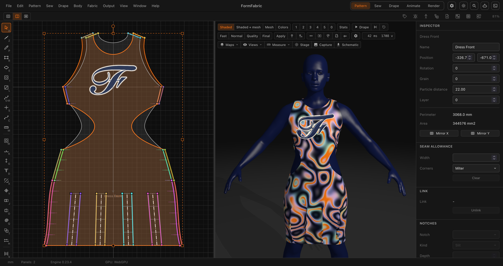

<p align="center">
  
</p>

<h1 align="center">FormFabric</h1>

<p align="center">
  <b>Garment design; sewing patterns draped on a body with a real cloth simulation.</b><br>
  Draw pattern pieces, sew them edge to edge, drape them, animate and export,<br>
  in one window on your own computer. Agents drive it over MCP.
</p>

<p align="center">
  
  
  
  
  
  
</p>

<p align="center">
  <a href="https://formai.studio/"><b>Download FormFabric on formai.studio</b></a> ·
  <a href="#run-it-from-source">Run it from source</a>
</p>

<br>

<p align="center">
  
  <br>
  <sub>The Pattern workspace: Dress Front selected on the flat pattern, the printed dress draped on a body in the 3D View.</sub>
</p>

<p align="center"><a href="#features">Features</a> · <a href="#everything-in-the-box">In the box</a> · <a href="#built-for-agents">Agents</a> · <a href="#under-the-hood">Under the hood</a> · <a href="#download">Download</a> · <a href="#run-it-from-source">Run from source</a></p>

<br>

<table>
  <tr>
    <td width="25%" valign="top"><h3>Pattern first</h3>Draw panels in millimetres with exact numeric input, darts, notches and seam allowance, and exchange them as DXF-AAMA.</td>
    <td width="25%" valign="top"><h3>Real cloth</h3>A native solver settles the fabric under gravity, contact and seams, with an opt-in GPU path on Metal, Vulkan and DX12.</td>
    <td width="25%" valign="top"><h3>To any 3D tool</h3>Export OBJ, FBX, glTF, USD and Alembic with UVs and caches, or save the whole garment as a <code>.ffbrc</code> project.</td>
    <td width="25%" valign="top"><h3>Agent-ready</h3>Every action is one engine command, so the window, a Python script and an AI agent over MCP drive the same document.</td>
  </tr>
</table>

<br>

## Features

- **Sewing patterns.** Flat panels carry seams, darts, grain lines and notches, with a live seam check in millimetres.
- **Exact drafting.** Draw panels in millimetres with numeric input, seam allowance and DXF-AAMA exchange.
- **Cloth simulation.** Fast, normal, quality and final presets, with pins, wind and body collision with skin offset.
- **Real bodies.** Drape on CC0 MPFB2 bodies or a Basic Form, then refit and re-drape as the pattern changes.
- **Finishing details.** Zippers, buttons, topstitch, piping, elastic, pleats and gather.
- **Animation.** A timeline with motion import and retargeting, recorded caches in layers, and keys for wind, fabric values and pins.
- **Export.** Weld or unweld, thick or thin, quad remesh with seam-matched borders, texture baking and game-ready output.
- **Any 3D tool.** OBJ, FBX, glTF, USD and Alembic with UVs and caches, or the whole garment as a `.ffbrc` project.
- **Home & library.** The window opens on Home: recent garments w/ previews, the four sample garments as templates & a Trash you can restore from, over a Garments folder on your own disk. Files outside that folder are never moved or deleted.

## Everything in the box

<table>
  <tr>
    <td width="33%" valign="top">
      <h4>Draft and sew</h4>
      Panels · Rectangles and ellipses · Curve tools · Darts · Slash and spread · Mirror and linked instances · Seams · Pleats · Gather · Tack
    </td>
    <td width="33%" valign="top">
      <h4>Drape and finish</h4>
      CC0 MPFB2 bodies · Basic Form · Pins · Grab and pinch · Fit shell · Refit and re-drape · Zippers · Buttons · Topstitch · Piping · Elastic
    </td>
    <td width="33%" valign="top">
      <h4>Formats</h4>
      Opens: <code>.ffbrc</code>, DXF-AAMA, OBJ, glTF, FBX, Alembic · Saves: <code>.ffbrc</code>, OBJ, FBX, glTF, GLB, USD, Alembic, MDD, PC2 · Native: <code>.ffbrc</code>
    </td>
  </tr>
</table>

## Built for agents

255 engine commands are declared once, in one registry; the UI, the Python package and the MCP server call the same ones.

```sh
./formfabric py -m formfabric commands   # list the engine commands
./formfabric py my_script.py             # run a script against the engine
./formfabric mcp                         # MCP server on stdio for Claude Code, Codex, Cursor and Antigravity
```

`.mcp.json`, `.codex/config.toml` and `.cursor/mcp.json` are already wired in this repo. See [`AGENTS.md`](AGENTS.md).

The agent dock (Ctrl+J, Cmd+J on a Mac) holds a shell, Chat & tabs that run the real Claude Code, Codex, Cursor & Antigravity w/ formfabric's MCP server already connected, each tab w/ its own key that ends when the tab closes. A program that is not installed shows its install line.

```sh
./formfabric agents install             # register formfabric w/ Claude Code, Codex, Cursor & Antigravity (--dry-run to preview)
./formfabric agents sync                # refresh the skills' tool reference, the .agents mirror & agents/manifest.json
./formfabric agents check               # validate the agent kit
```

## Under the hood

- **Engine:** a Rust workspace of 14 crates, with a native cloth solver (block descent and implicit) and an opt-in wgpu compute path
- **Interface:** vanilla TypeScript and Vite, with the shared Form shell, zero flash on load and every string in 30 languages
- **Service:** Python and FastAPI on 127.0.0.1 only, with autosave, a recovery journal and plugins
- **Desktop:** Tauri 2, with the engine as a sidecar and the frame stream as a binary WebSocket; the Form family splash & menu bar, w/ the same menus in the native macOS menu bar
- **Scripting:** a standard-library Python package, plus a Live Link that streams a USD layer to Unreal

## Download

| Platform | Download | Release |
|---|---|---|
| macOS | [Download FormFabric for macOS](https://formai.studio/get/formfabric/macos) | [FormFabric releases on FormCompiler](https://github.com/nodemode-dev/formcompiler/releases?q=formfabric-v&expanded=true) |
| Windows | [Download FormFabric for Windows](https://formai.studio/get/formfabric/windows) | [FormFabric releases on FormCompiler](https://github.com/nodemode-dev/formcompiler/releases?q=formfabric-v&expanded=true) |
| Linux | [Download FormFabric for Linux](https://formai.studio/get/formfabric/linux) | [FormFabric releases on FormCompiler](https://github.com/nodemode-dev/formcompiler/releases?q=formfabric-v&expanded=true) |

All FormFabric builds are compiled and released from [FormCompiler](https://github.com/nodemode-dev/formcompiler); this repo holds the source.

## Run it from source

Prefer it in your browser, or want to contribute? Run the web UI straight from this repo.

**Requires:** Node 20.19+ (22 recommended), Python 3.12+, and Rust at the version pinned by `rust-toolchain.toml` (installed by `rustup`). `./formfabric doctor` checks them.

```sh
git clone git@github.com:nodemode-dev/formfabric.git
cd formfabric
./formfabric_oc_install     # installs the backend, the engine and the frontend
./formfabric                # web UI at http://localhost:5280
```

`./formfabric desktop dev` opens the desktop window instead.

On Windows use `formfabric_oc_install.bat` and `formfabric.bat`. The backend listens on 127.0.0.1:8280 only. `FORMFABRIC_DATA_DIR` moves autosaves, recovery, the Library and the Garments folder Home lists.

> [!IMPORTANT]
> **Status:** released. FormFabric is built and bundled for macOS, Windows and Linux and has been tested on all three. The Live Link to Unreal has not been tried against Unreal itself ([`docs/integration/unreal-live-link.md`](docs/integration/unreal-live-link.md)); see the [CHANGELOG](CHANGELOG.md) for what each version brings.

**Contributing:** branch from `main`, keep changes to source here, and leave packaging and releases to formcompiler. See [`CONTRIBUTING.md`](CONTRIBUTING.md), [`.docs/BRANCHING.md`](.docs/BRANCHING.md) and [`AGENTS.md`](AGENTS.md).

Layout: `native/` (engine), `frontend/`, `backend/`, `python/`, `src-tauri/`, `setup/`, `assets/`. Docs: [`.docs/wiki`](.docs/wiki) · Agents: [`CLAUDE.md`](CLAUDE.md), [`AGENTS.md`](AGENTS.md) · Contributing: [`.docs/BRANCHING.md`](.docs/BRANCHING.md)

<br>

---

## Maintainers

| Maintainer | Role |
|---|---|
| [@nodemode-ai](https://github.com/nodemode-ai) | Owner |
| [@gbarnai](https://github.com/gbarnai) | Co-owner |

Code owners are set in [`.github/CODEOWNERS`](.github/CODEOWNERS).

## License

FormFabric is licensed under the Apache License 2.0 ([`LICENSE`](LICENSE), SPDX `Apache-2.0`). Copyright 2026 NodeAgentc, Inc. Third-party notices: [`NOTICE.md`](NOTICE.md).

<sub>Screenshot content: the owner's dress project on a CC0 MPFB2 body.</sub>
